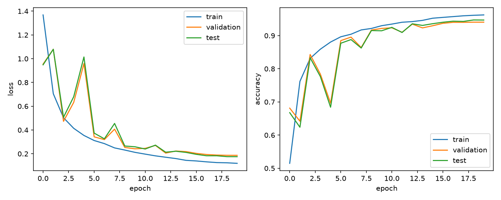

A VGG-style convolutional network for CIFAR-10 image classification, written in PyTorch
and trained on an AMD GPU (9070xt) (ROCm, WSL).

- **Model:** three blocks of (conv, batch norm, ReLU) x2 + max pool, then a small MLP head with dropout
- **Training:** Adam, cosine learning-rate schedule, bf16 mixed precision
- **Augmentation:** random horizontal flip and random crop (train only), per-channel normalization
- **Test accuracy:** XX%

`results/` also holds example predictions and the confusion matrix.

## Run

Install PyTorch and torchvision for your platform (ROCm 7.2 wheels were used here), plus
`numpy`, `matplotlib` and `scikit-learn`, then run from this folder:

    python train.py

CIFAR-10 downloads into `./data` on the first run.
