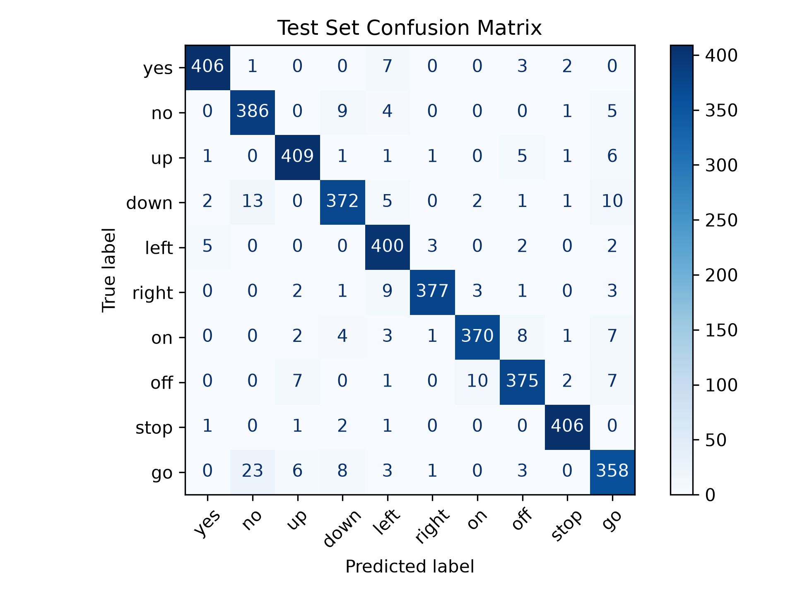

Speech Commands CNN

Classifies ten spoken commands (yes, no, up, down, left, right, on, off, stop, go) from the
Google Speech Commands dataset, written in PyTorch and trained on an AMD GPU (ROCm, WSL).

- **Features:** one-second clips converted to a log-mel spectrogram (64 mel bins, 101 frames),
  standardized per clip
- **Model:** three conv blocks (conv, batch norm, ReLU, max pool) and a small pooled head
- **Training:** AdamW, cosine learning-rate schedule, best-validation checkpoint
- **Test accuracy:** about 94%

## Run

Install PyTorch and torchaudio for your platform (ROCm 7.2 wheels were used here), plus
`numpy`, `matplotlib` and `scikit-learn`, then run from this folder:

    python voiceRecogn.py

The dataset (about 2 GB) downloads into `./data` on the first run. Plots are saved to `./outputs`.
